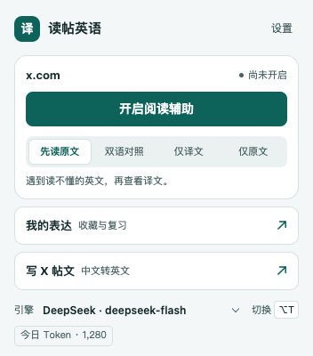
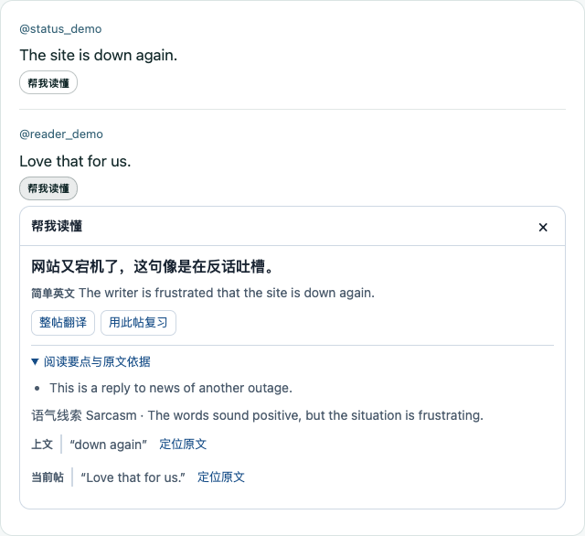
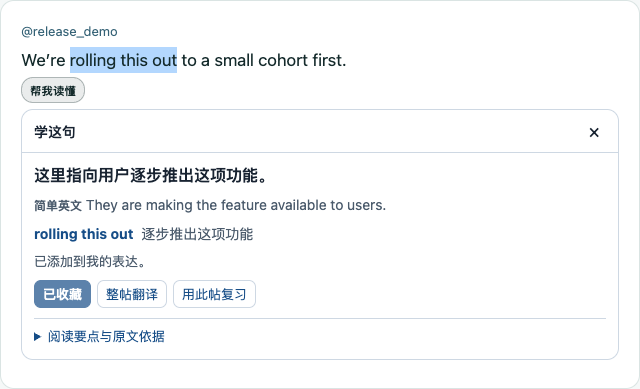
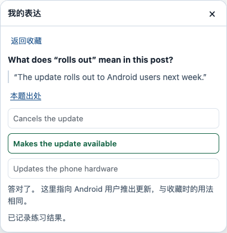
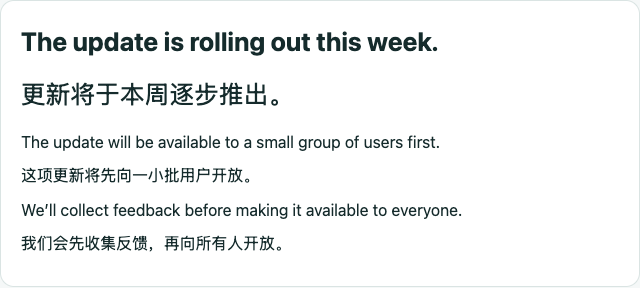
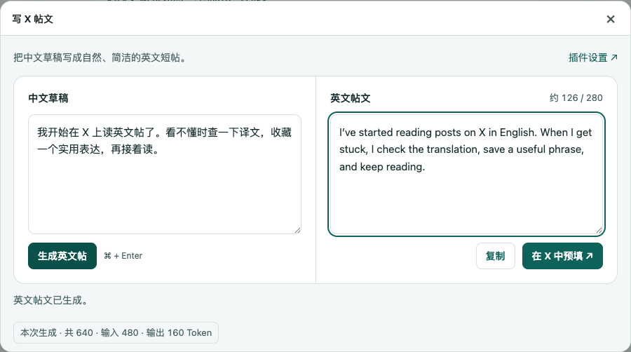
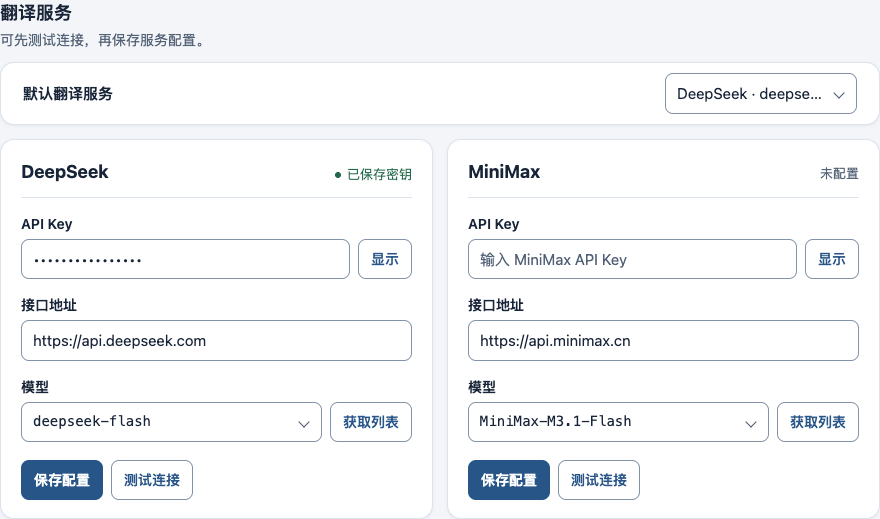
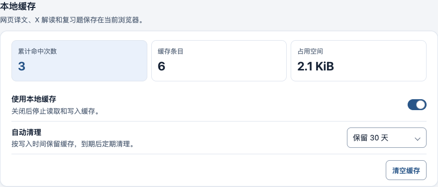
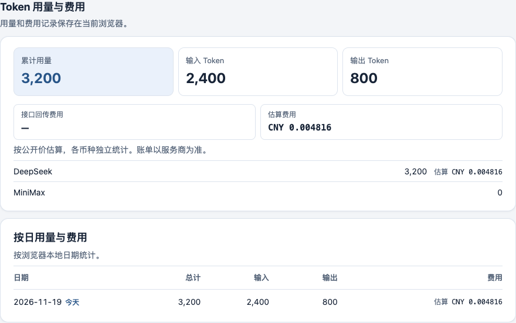

# Post English · 读帖英语

[简体中文](README.md) | English

Post English is a Chrome extension for Chinese-speaking English learners who read X. Get help with a post or phrase, save expressions in context, and review them in another real post. The extension also translates web pages and helps turn Chinese drafts into English posts. It uses the DeepSeek or MiniMax service you configure.

Screenshots show the actual extension interface with sample posts, translations, and usage data.

## Install and get started

1. Download and extract `post-english-v<version>.zip` from the repository’s Releases page, or download or clone the source. Use the folder containing `manifest.json`. No build step is required.
2. Open `chrome://extensions/`, enable **Developer mode**, click **Load unpacked**, and select that folder. To update an existing installation, replace the files in the original folder, click **Reload** on the extension card, and refresh the web page.
3. Open **Settings** (设置) from the extension popup. Enter a DeepSeek or MiniMax API key, test the connection, save your settings, and select your default provider.
4. Open an English post on X and click **Help me understand** (帮我读懂) below the post. The extension interface is in Simplified Chinese.

## Learn English on X

### Understand a post

Click **帮我读懂** below an English post for a short Chinese explanation and a simple English paraphrase. Use **整帖翻译** when you want the full translation. For example, *Love that for us.* may be sarcastic in reply to a report that a site is down again. The extension can use the post being replied to or quoted when it can verify the link on the current page. Expand **阅读要点与原文依据** for notes on tone and supporting quotes, then click **定位原文** to locate the source text. The explanation flags uncertainty when context is limited.

### Look up and save a phrase

Highlight a phrase such as *rolling this out* and click **学这句** to see what it means in that post. Use **收藏表达** to save the expression, its meaning, the original sentence, and the source post. Open **My Expressions** (我的表达) from the toolbar popup to revisit the sentence or jump back to its source.

### Review with another post

Click **在 X 找例句** in **我的表达** to look for an example, or find one in your feed. Open an X post that uses the same expression or a variant, then choose **用当前帖复习**. Answer the question using the new post. The extension shows the explanation after you answer and records the result. For example, you can save *rolling this out* and later review *rolls out* in another post.

Learning features run on X. Browsing and selecting text do not send learning requests on their own. Relevant text is sent when you request an explanation or a review question. Saved expressions and review history are stored locally in Chrome. Automatic page translation has its own setting.

## Translate web pages

Enable reading assistance on the current tab from the toolbar popup. You can also toggle it from the floating page controls or with the keyboard shortcut, or right-click selected text to translate it. In Settings, you can choose whether to enable reading assistance automatically on newly opened English pages.

| Reading mode | What you see |
| --- | --- |
| Read the original first (先读原文, default) | Click **查看译文** below an English paragraph to request its translation. You can collapse the translation anytime. |
| Bilingual (双语对照) | The translation appears below the original text. New text is translated as you scroll or as the page adds content. |
| Translation only (仅译文) | The translation replaces ordinary paragraphs once it is ready. Table cells show both versions. |
| Original only (仅原文) | Translations and vocabulary highlights are hidden. |

In bilingual mode, each translation appears below the original paragraph at the same font size. Enable **高亮英语词汇和句型** to highlight expressions the model identifies as harder to read.

The extension supports some short-post layouts on X and Facebook. Facebook comments, detail overlays, and layouts across sign-in states still need testing on the live site. See the [privacy and permissions guide (Chinese)](PRIVACY.md).

## Write an X post

Choose **写 X** from the floating controls to open the editor on the current page. Enter a Chinese draft to generate an English version. You can edit it, copy it, or choose **在 X 中预填** to open a prefilled X composer and publish it there. Closing and reopening the editor on the same page preserves your draft. The editor estimates the weighted character count for a standard post.

## Model list

The provider selector in the toolbar popup shows both your provider and selected model. Enter the provider URL and API key in Settings, then fetch the model list. The dropdown shows the model IDs returned by that endpoint. If the request fails or the list is empty, you can keep the current settings or enter a model ID manually. Fetching the list does not save your settings.

Available models depend on the endpoint you configure. [DeepSeek model list](https://api-docs.deepseek.com/api/list-models/) · [MiniMax model list](https://platform.minimax.cn/docs/api-reference/models/openai/list-models)

## Local cache

Settings shows lifetime cache hits, the current entry count, and storage used by page translations, X explanations, and review questions. Entries are kept for 30 days by default. You can select 7 or 90 days, or turn off time-based cleanup. The retention period starts when an entry is saved. Older translations without timestamps start their retention period on the first automatic cleanup. Clearing the cache preserves the hit counter, saved expressions, and review history.

Disabling **使用本地缓存** stops the extension from reading or writing cached entries. The hit counter increases for each entry reused from local storage.

## Token usage

The pinned Chrome toolbar icon and the floating page controls show today’s token usage. The count updates when a model responds. Hover over the counter for the full value. Select today’s usage in the toolbar popup to open Settings and see daily records, cumulative totals, input and output totals, and provider subtotals. The post editor shows usage returned for the latest generation.

Daily records use the browser’s local date when the model response arrives. Usage covers successful model responses for translation, drafting, vocabulary analysis, explanations, review questions, and connection tests. Cache hits do not count again. When an API reports incomplete usage, the extension records the available fields and marks the entry as incomplete. The total can exceed the sum of the known input and output counts.

As of v1.4.0, daily and cumulative records include cost. The extension records the amount and currency reported by the API when available. For supported official models, it otherwise estimates cost from published prices. DeepSeek estimates use CNY rates, peak and off-peak hours in Beijing time, and a built-in holiday calendar for 2026 and 2027. MiniMax estimates use CNY or USD depending on the official endpoint. Subscription keys, incomplete usage, and records from before the upgrade may lack cost data. Currencies are shown separately. Check your provider’s bill for actual charges. [DeepSeek pricing](https://api-docs.deepseek.com/zh-cn/quick_start/pricing/) · [MiniMax China pricing](https://platform.minimax.cn/docs/pricing/overview) · [MiniMax international pricing](https://platform.minimax.io/docs/pricing/overview)

## Develop and contribute

This Manifest V3 extension uses plain JavaScript. With Node.js 24 or later, run `npm test` to run the tests and `npm run package` to build the ZIP. Packaging requires the `zip` command. See the [contribution guide](CONTRIBUTING.md), [security reporting guide](SECURITY.md), and [changelog](CHANGELOG.md) for project details. These guides are in Chinese.

- `popup/` shows the current page status and lets you switch reading modes and providers.
- `options/` manages reading preferences, provider setup, connection tests, and caches.
- `compose/` rewrites Chinese drafts in English and can open a prefilled X composer.
- `content.js` detects page text, updates translations in feeds, and shows the selection popup.
- `x-context.js` identifies X post text, replies, and quotes. `x-learning.js` connects page interactions to the background worker. `x-learning-ui.js` renders explanations, saved expressions, and review questions.
- `background.js` handles settings, caches, keyboard shortcuts, model requests, and local learning records.

## License

[MIT](LICENSE)
