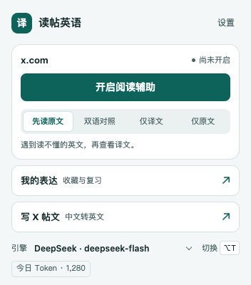
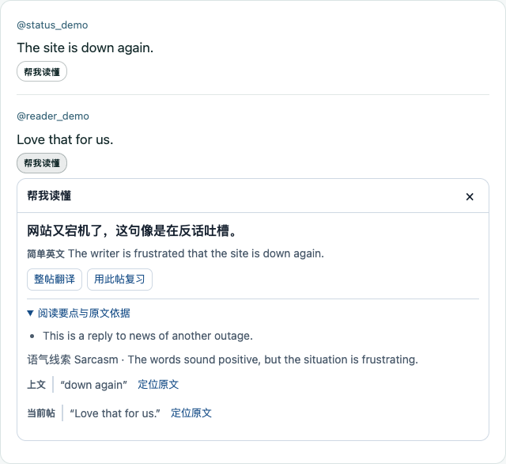
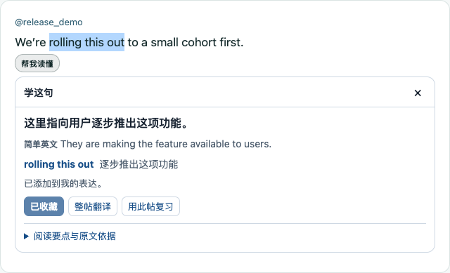
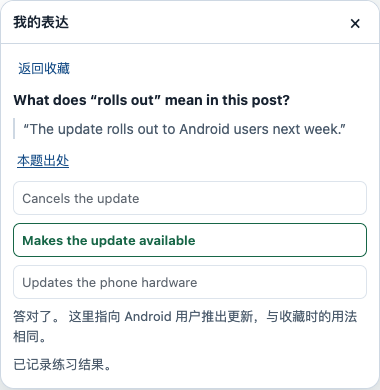
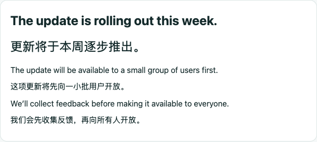
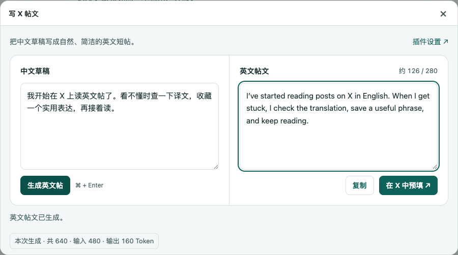
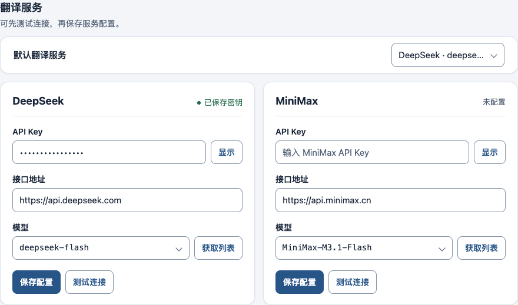
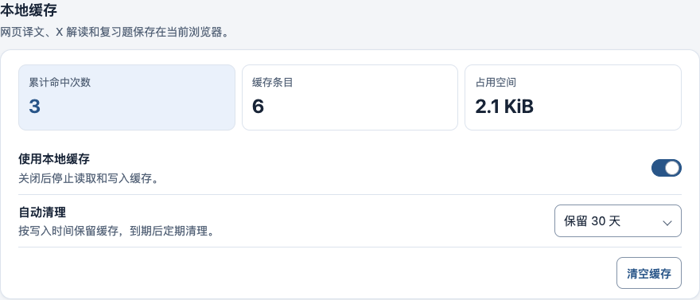
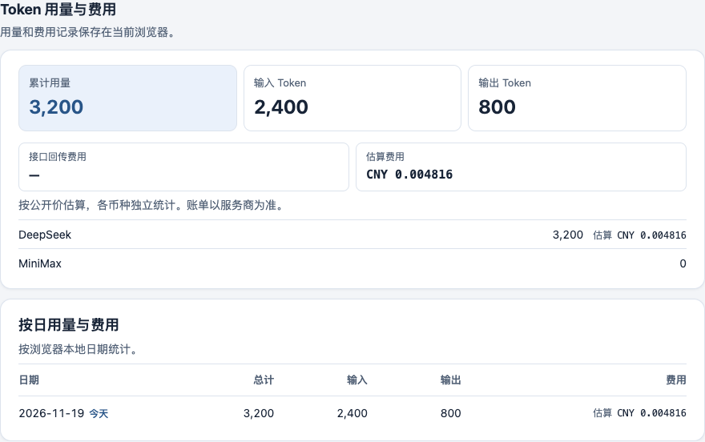

# 读帖英语 · Post English

简体中文 | [English](README.en.md)

在 X 上读英文原帖，遇到看不懂的内容时查大意和用法，把想记住的表达留到下一条帖里复习。读帖英语是一个 Chrome 扩展，也支持网页翻译和中文草稿转英文 X 帖文。模型请求使用你在设置中配置的 DeepSeek 或 MiniMax。

下方截图来自扩展实际界面，使用示例帖子、译文和模型用量。

## 安装与使用

1. 从仓库的 Releases 下载 `post-english-v<版本>.zip` 并解压，也可以直接下载或克隆源码。使用包含 `manifest.json` 的目录，无需构建。
2. 打开 Chrome 的 `chrome://extensions/`，开启「开发者模式」，选择「加载已解压的扩展程序」，然后选中该目录。更新已有安装时，在原目录更新文件并点击扩展卡片上的「重新加载」，再刷新网页。
3. 打开扩展的「设置」，填写 DeepSeek 或 MiniMax 的 API Key。测试连接后保存，并选择默认服务。
4. 打开 X，找到一条英文帖，点击正文旁的「帮我读懂」。

## 在 X 学英语

### 帮我读懂

点英文帖下方的「帮我读懂」，先看中文大意和一句简单英文，需要完整译文时再点「整帖翻译」。例如，字面上像在夸赞的 *Love that for us.*，如果是回复「网站又宕机了」，就可能是在吐槽。扩展使用当前页面能确认的直接上文或引用帖。展开「阅读要点与原文依据」可以查看语气和引文，点击「定位原文」跳回对应文字。上下文不足时，解读会标明不确定性。

### 学这句与收藏表达

划选 *rolling this out* 一类读不懂的短语，点「学这句」，查看它在当前帖里的含义。「收藏表达」会保存短语、释义、原句和帖子来源。之后可以从工具栏弹窗打开「我的表达」，查原句或回到收藏出处。

### 换一条帖复习

在「我的表达」点击「在 X 找例句」，或在信息流中自己挑一条新帖。打开包含同一表达或词形变体的帖子详情页，选择「用当前帖复习」。题目用新帖的原句出题，作答后才显示解析，并记录答题结果。例如，收藏的是 *rolling this out*，复习时可以用另一条帖里的 *rolls out*。

学习功能只在 X 页面启用。默认浏览或划选原文不会发送学习请求，点击解释或生成复习题时才会发送相关内容。收藏和复习记录保存在当前 Chrome 的本地扩展存储中。网页自动翻译仍由原有开关控制。

## 网页翻译

打开工具栏弹窗开启当前页面的阅读辅助。也可以点击网页浮球或用快捷键启停，或者右键翻译选中的文字。设置页可控制新打开的英文网页是否自动启用。

| 阅读模式 | 页面表现 |
| --- | --- |
| 先读原文（默认） | 点击英文段落下方的「查看译文」后请求翻译，可随时收起。 |
| 双语对照 | 在视窗内的正文下方展示译文，滚动或新增内容时补翻。 |
| 仅译文 | 普通段落在译文可用后隐藏原文。表格单元格保留原文和译文。 |
| 仅原文 | 隐藏当前译文和词汇标记。 |

在双语对照中，译文直接出现在对应段落下方，字号跟随原文。开启「高亮英语词汇和句型」后，扩展会在原文中标出模型识别的较难表达。

扩展支持 X 和 Facebook 的部分短帖版式。Facebook 评论、详情弹层和不同登录状态下的版式有待实站验证。更多权限和数据说明见 [隐私说明](PRIVACY.md)。

## 写 X 帖文

点击网页右侧悬浮工具的「写 X」，即可在当前网页打开写帖窗口。输入中文草稿生成英文，生成后可编辑、复制或点击「在 X 中预填」，再在 X 确认发布。关闭同页窗口后重新打开，草稿仍在。界面提供普通帖的加权字符数估算。

## 模型列表

工具栏弹窗的引擎选项同时显示服务商和已选模型。在设置中输入服务地址和 API Key，再获取模型。下拉列表显示该接口实际返回的模型 ID。请求失败或列表为空时可保留当前配置，也可手填模型 ID。获取模型不会保存草稿配置。

模型支持以所填服务地址返回的列表为准。 [DeepSeek 模型列表](https://api-docs.deepseek.com/api/list-models/) · [MiniMax 模型列表](https://platform.minimax.cn/docs/api-reference/models/openai/list-models)

## 本地缓存

设置页显示网页译文、X 解读和复习题的累计缓存命中次数、当前条目数与占用空间。缓存默认保留 30 天，也可选 7 天、90 天或关闭按时间清理。保留时间从写入时起算。旧版没有时间记录的译文会在首次自动清理时开始计时。清空缓存会保留命中次数、收藏和复习记录。

「使用本地缓存」关闭后，扩展停止读取或写入缓存。命中次数统计的是本地缓存复用，按返回的条目累计。

## Token 用量

固定到 Chrome 工具栏的插件图标和网页悬浮工具都显示今日用量。模型响应返回后更新数字，悬停可查看完整值。点开工具栏弹窗中的今日用量，可在设置中查看按日记录、累计总量、输入、输出和各厂商小计。写帖窗口也会显示最近一次生成回传的用量。

每日记录按模型响应到达时的浏览器本地日期归档。统计覆盖翻译、写帖、词汇分析、解读、复习和连接测试的成功模型响应。缓存命中不会重复计入。接口只返回部分字段时会累计已知字段并标记该次响应不完整，可能出现总量大于已知输入和输出之和的情况。

从 1.4.0 起，累计和按日用量附带费用。有明确金额和币种时记录接口回传值，否则对支持的官方模型按公开价格估算。DeepSeek 用人民币公开价及北京时间峰谷规则估算，内置 2026、2027 年节假日。MiniMax 费用按接入的官方站点使用人民币或美元价格。套餐 Key、用量不全及升级前的数据可能无法计价。不同币种分别展示，实际扣款以服务商账单为准。 [DeepSeek 定价](https://api-docs.deepseek.com/zh-cn/quick_start/pricing/) · [MiniMax 中国站](https://platform.minimax.cn/docs/pricing/overview) · [MiniMax 国际站](https://platform.minimax.io/docs/pricing/overview)

## 开发与贡献

这是原生 JavaScript 编写的 Manifest V3 扩展。使用 Node.js 24+ 运行 `npm test`，用 `npm run package` 生成安装包。打包需要本机提供 `zip` 命令。提 Issue、提交 PR 和发版步骤见 [贡献指南](CONTRIBUTING.md)。安全问题请参阅 [安全报告指南](SECURITY.md)，版本变更见 [更新记录](CHANGELOG.md)。

- `popup/` 显示当前页面状态、切换阅读模式和翻译服务。
- `options/` 管理阅读偏好、服务配置、连接测试和缓存。
- `compose/` 将中文草稿改写为英文，并可在 X 中打开预填编辑器。
- `content.js` 识别正文、更新信息流内的译文和划词浮层。
- `x-context.js` 识别 X 正文、回复和引用。 `x-learning.js` 连接 X 页面交互与后台，`x-learning-ui.js` 渲染解释、收藏和复习。
- `background.js` 处理配置、缓存、快捷键、模型请求和本地学习记录。

## 许可证

[MIT](LICENSE)
